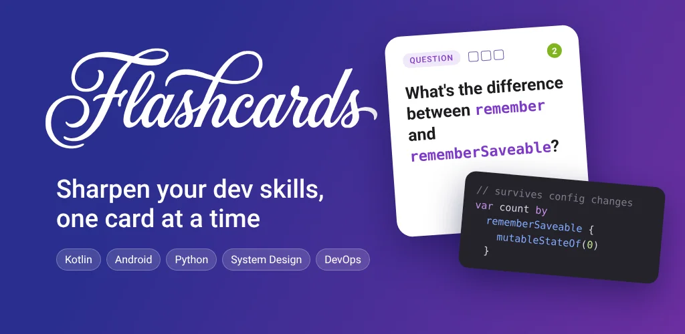
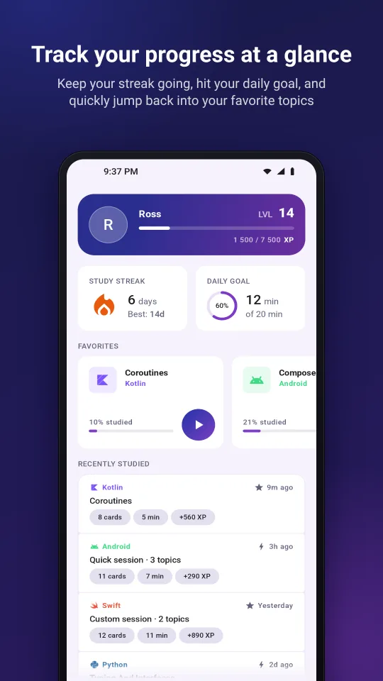
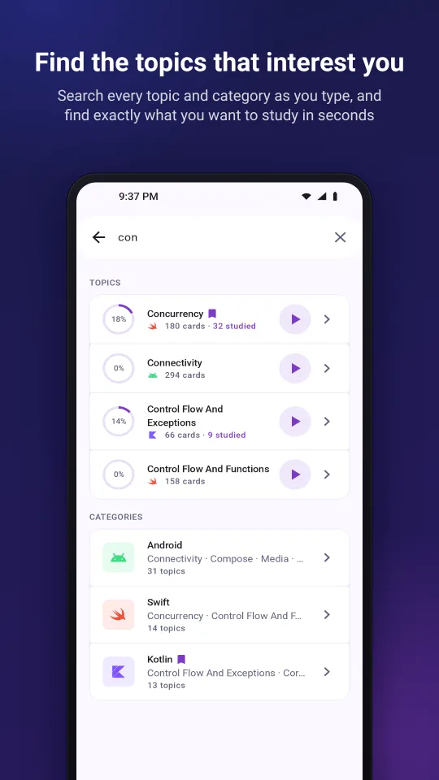
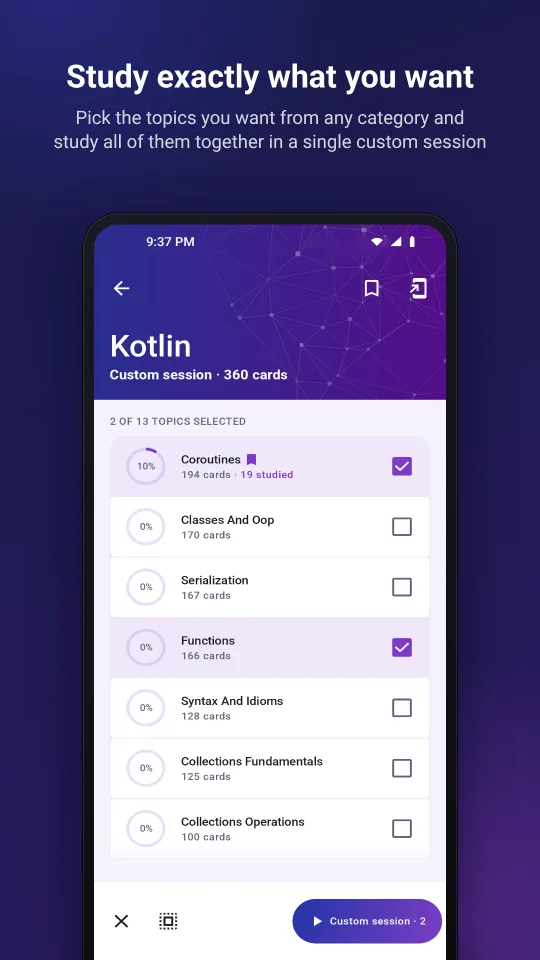
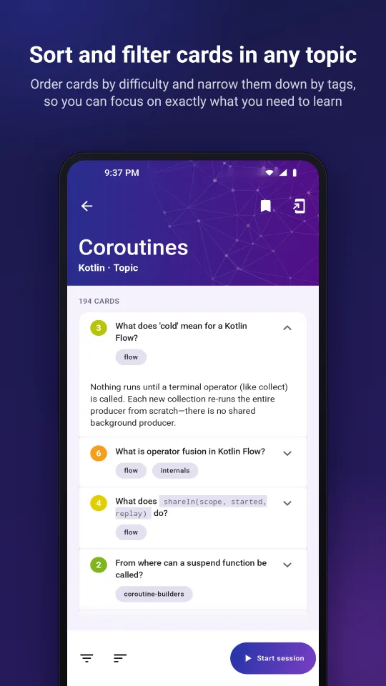
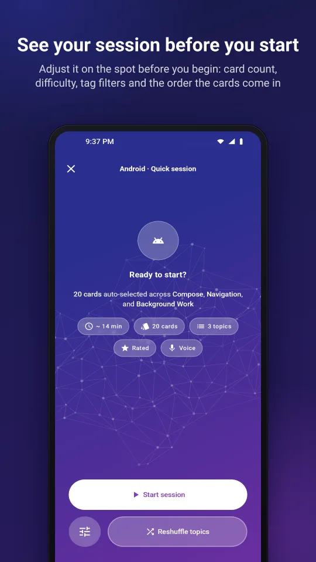
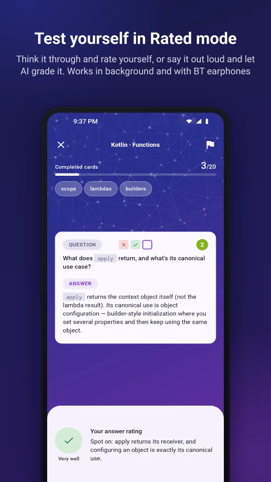
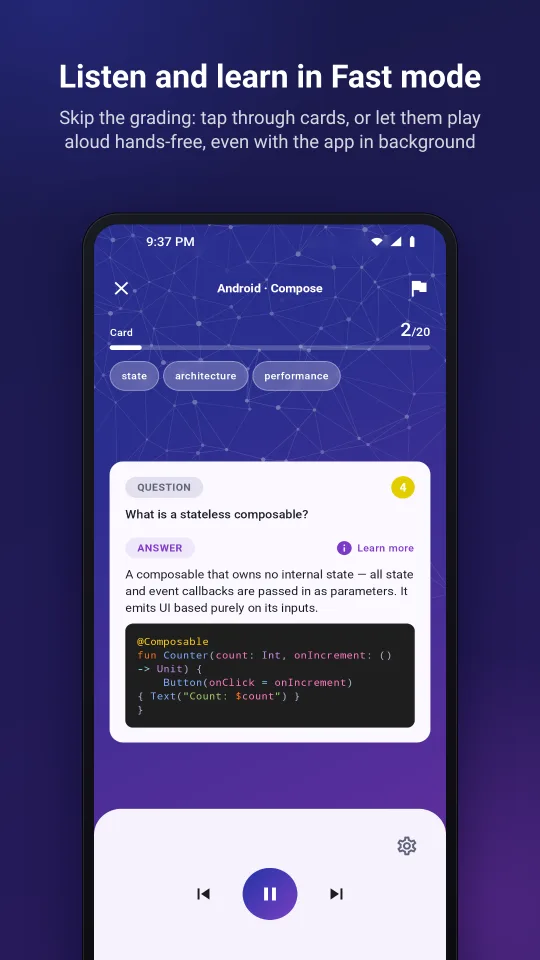
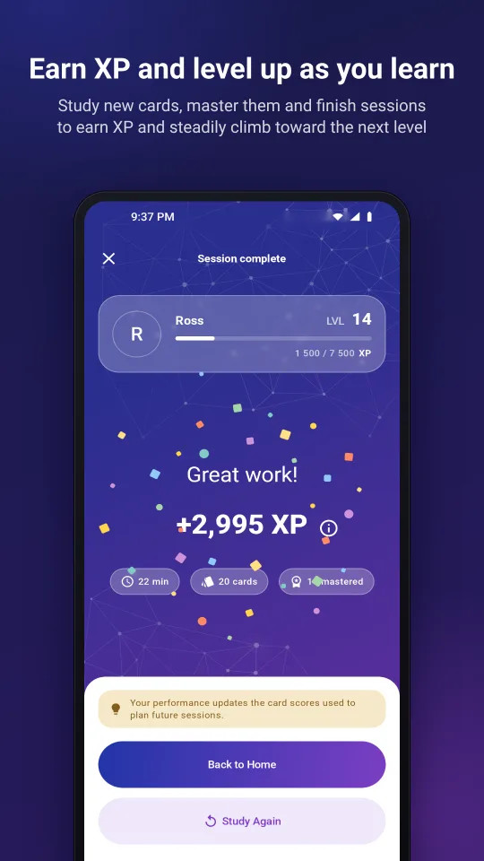
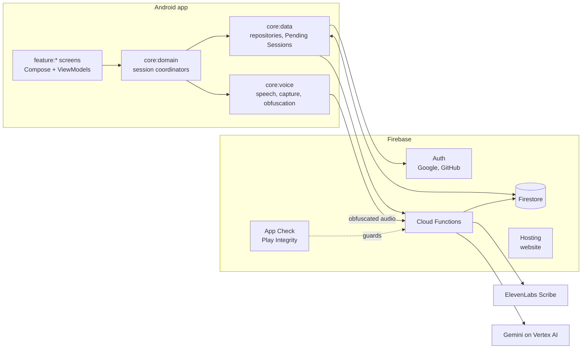

  

<h1 align="center">Flashcards</h1>

  <b>Study developer flashcards by tapping, listening, or answering out loud.</b>

  
  
  
  
  

An Android app with curated flashcards for developers: Kotlin, Android, Swift, Python, Machine Learning and more.
Pick topics, preview the session, then study it your way: tap through the cards, let them play aloud hands-free, or
answer out loud and have the answer graded for you. Progress, XP, Levels and Streaks keep you coming back.

Built solo as a portfolio project. In closed testing on Google Play. Website and privacy policy:
[flashcards-8ad6d.web.app](https://flashcards-8ad6d.web.app).

## Features

<table>
  <tr>
    <td width="300"></td>
    <td>
      <h3>Track your progress at a glance</h3>
      
Home opens on your Level and XP, your Streak and today's minutes against your Daily Goal. Below them, a
      carousel of your favorite Categories and Topics starts a session in one tap, and the Recently studied list
      replays any past session.

      
<a href="docs/design/home.md">How it works →</a>

    </td>
  </tr>
</table>

<h3>Find the topics that interest you, and study exactly what you want</h3>

  
  

Search finds Categories and Topics live as you type. Inside a Category, start a session for one Topic, let a Quick
Session pick a random mix, or long-press to enter Selection Mode and combine the Topics you choose into one custom
session. [How it works →](docs/design/browse.md) · [Search →](docs/design/category-search.md)

<h3>See your session before you start</h3>

  
  

Each Topic lists its cards, filtered by tags and sorted by difficulty. Every session, whichever way it starts, opens
on a preview showing its card count and estimated time, where you choose the mode, the length, the difficulty range,
the filters and the card order. [How it works →](docs/design/preview-study-session.md) ·
[Card selection →](docs/design/flashcard-selection.md)

<table>
  <tr>
    <td width="300"></td>
    <td>
      <h3>Test yourself in Rated mode</h3>
      
Reveal the answer and rate yourself Failed, Partial or Correct, or turn on Voice Answering: the question is
      read aloud, you answer out loud, and the transcript and grade arrive within seconds. Weaker cards come back
      later in the session, and each card's best rating decides whether it is Mastered. Voice Answering keeps going
      with the screen off and works with Bluetooth earphones.

      
<a href="docs/design/rated-mode.md">How it works →</a> · <a href="docs/design/voice-answering.md">Voice Answering →</a>

    </td>
  </tr>
  <tr>
    <td width="300"></td>
    <td>
      <h3>Listen and learn in Fast mode</h3>
      
No grading: tap through question and answer, or turn on read-aloud and the app reads each question, pauses,
      reads the answer and moves on. Playback continues in the background, with controls in the notification, on the
      lock screen and on your headset.

      
<a href="docs/design/fast-mode.md">How it works →</a>

    </td>
  </tr>
  <tr>
    <td width="300"></td>
    <td>
      <h3>Earn XP and level up as you learn</h3>
      
The Session Summary breaks down the XP the session earned: new cards, mastered cards, defended mastery,
      finishing the session, the Daily Goal and the Streak. The Level card fills and pulses for every Level crossed.
      The score appears at once, even offline.

      
<a href="docs/design/session-summary.md">How it works →</a> · <a href="docs/design/xp-leveling-system.md">XP and Levels →</a>

    </td>
  </tr>
</table>

### More features

- Favorite Categories and Topics, and a Recently studied list that replays any past session
- Streak and Daily Goal
- Launcher shortcuts to any Category or Topic, pinned or mirroring your Favorites
- Onboarding with an on-device voice test
- Sign-in with Google or GitHub
- Report a problem on a card, or send a Bug Report from the app
- In-app Account Deletion
- Portrait on phones, free rotation on large screens

## How it's built

- **Server-authoritative session commit.** A finished session is scored and recorded by a Cloud Function in one
  Firestore transaction: the session, Card Progress, XP, Level, Streak and Daily Goal move together or not at all.
  [ADR-0049](docs/adr/0049-server-authoritative-session-commit.md) · [Session submission](docs/design/session-submission.md)
- **Offline-enabled.** A finished session waits on the device as a Pending Session and is delivered when the
  connection returns. It counts toward progress, XP and Streak at once, scored on the device with the server's rules.
  [ADR-0055](docs/adr/0055-pending-sessions-and-local-progress-projection.md)
- **On-device voice obfuscation.** Every spoken answer has its pitch and formants shifted by a random amount before
  it leaves the phone, so the upload no longer carries the speaker's voiceprint.
  [Voice obfuscation](docs/design/voice-obfuscation.md)
- **Streamed transcribe-then-grade.** One streaming callable transcribes the answer with ElevenLabs Scribe, has
  Gemini clean the transcript and streams it back, then has Gemini grade it, so you read your answer while the
  grade is on its way.
  [ADR-0028](docs/adr/0028-voice-answering-not-background-only-streamed-transcript-then-grade.md) ·
  [Voice Answering backend](docs/design/voice-answering.md#backend)
- **Enforced architecture.** Multi-module Clean Architecture (`feature:*` over `core:*`), with layer and naming
  rules checked by Konsist and a static-analysis gate (Spotless, detekt, Android Lint) on every pull request.
  [ADR-0011](docs/adr/0011-multi-module-architecture.md) · [CI/CD](docs/ci-cd.md)
- **Spoken sessions that survive real life.** Playback runs in the background and with the screen off through a
  MediaSession, the microphone routes to Bluetooth earphones, and custom handling of audio interruptions tells a
  notification from a call: short sounds are ignored, an alarm pauses and resumes, a call pauses until you play again.
  [Spoken sessions](docs/design/study-session.md#spoken-sessions) ·
  [ADR-0027](docs/adr/0027-bluetooth-mic-capture-le-audio-first-sco-fallback-bt-strict-screen-off.md)

### Tech stack

| Area | Technologies |
|---|---|
| App | Kotlin 2.4, Jetpack Compose, Material 3, Hilt, Coroutines and Flow, Media3 and MediaSession, Kotlinx Serialization, min SDK 26, target SDK 36 |
| Backend | Firebase Auth, Firestore, Cloud Functions (TypeScript, Node 22), App Check with Play Integrity, Crashlytics, Hosting |
| AI | ElevenLabs Scribe for speech-to-text, Gemini on Vertex AI for grading |
| Tooling and CI | Bitrise, Spotless with ktlint, detekt, Android Lint, Konsist, Firestore security rules tests |

### Also in this repo

- **Website** (`:web`): the public site and privacy pages, written in Compose Multiplatform for the browser (wasm)
  and sharing the app's design tokens. [ADR-0068](docs/adr/0068-website-is-a-compose-multiplatform-wasm-app.md)
- **[Morpheus](https://github.com/rmakowiecki/Morpheus)**: the animated graph background, a separate library of mine
  consumed as a versioned git submodule. [ADR-0069](docs/adr/0069-morpheus-is-an-external-library-built-from-a-submodule.md)

## Documentation

| Where | What |
|---|---|
| [docs/design/](docs/design/INDEX.md) | Current design of each feature, one doc per feature |
| [docs/adr/](docs/adr/) | Architecture decision records: decisions and rejected alternatives |
| [docs/user-flow/](docs/user-flow/) | Per-screen action flows as Mermaid diagrams |
| [CONTEXT.md](CONTEXT.md) | Domain glossary |
| [TESTING.md](TESTING.md) | Testing conventions |
| [docs/ci-cd.md](docs/ci-cd.md) | CI pipeline on Bitrise |
| [functions/README.md](functions/README.md) | Cloud Functions setup and contracts |
| [scripts/seed/README.md](scripts/seed/README.md) | Flashcard content seeding into Firestore |

## Development

The app needs a private Firebase project, so it can't be built from a fresh clone.
Setup, commands and checks: [docs/development.md](docs/development.md).

## License

Copyright 2026 Radosław Makowiecki. The source code is licensed under the [Apache License 2.0](LICENSE).

The flashcard content and the brand assets (the Flashcards name, app icon and feature graphic) are not covered by
the license: all rights reserved.
