

  <a href="https://flashcards-8ad6d.web.app">
    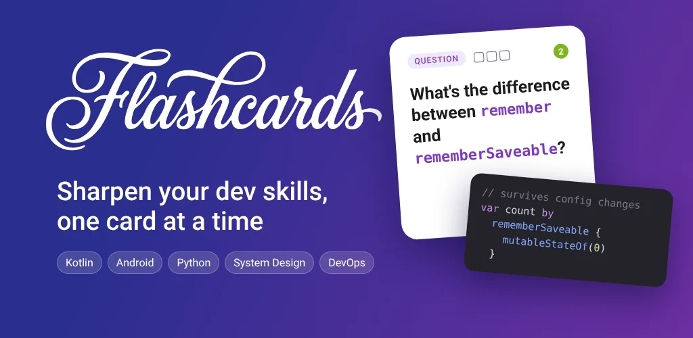
  </a>

<h1 align="center">Flashcards</h1>

  <b>Android flashcards for developers, with read-aloud sessions and spoken answers graded by an LLM.</b>

  
  
  
  
  
  
   
  

An Android app with curated flashcards for developers (Kotlin, Android, Swift, Python, Machine Learning and more),
built as a multi-module Kotlin and Jetpack Compose client on a Firebase backend. It has three ways to study:
tap-through, hands-free read-aloud, and Voice Answering, where a spoken answer is transcribed and graded by an LLM.
XP, Levels and Streaks score each session, gamifying the experience to increase retention.

In closed testing on Google Play. Website and privacy policy:
[flashcards-8ad6d.web.app](https://flashcards-8ad6d.web.app).

## Design system

  <a href="https://claude.ai/artifact/EJtwc7qDnTDipnJSSeKYW8">
    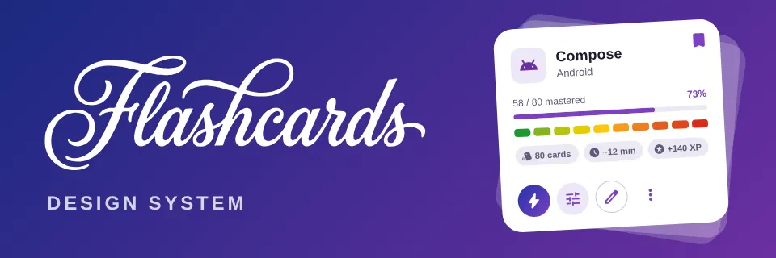
  </a>

The app's [design system](https://claude.ai/artifact/EJtwc7qDnTDipnJSSeKYW8) is public, made with Claude Design: brand
colors and typography, spacing and shape tokens, reusable components, and mockups of the app's screens. It is the source
of truth and the reference for the whole app UI.

## Features

<table>
  <tr>
    <td>
      <table>
        <tr>
          <td>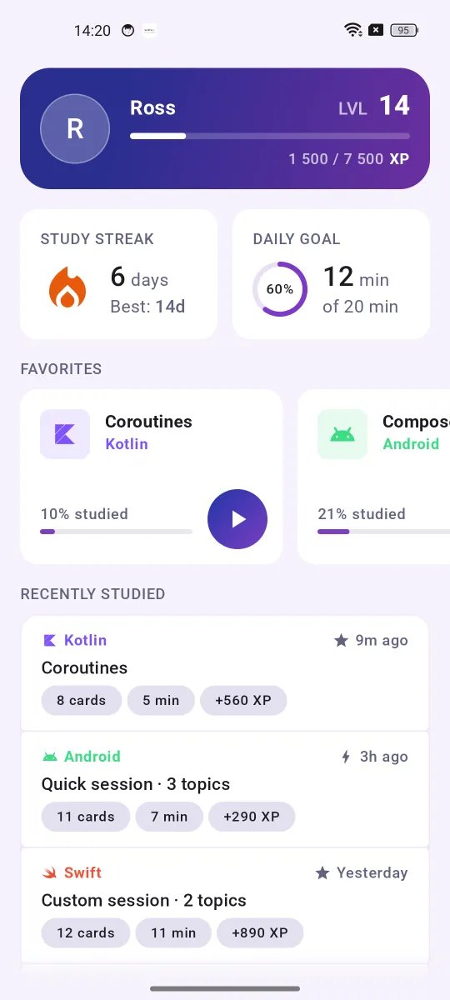</td>
          <td>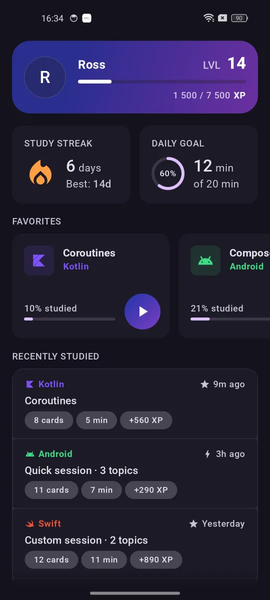</td>
        </tr>
      </table>
    </td>
    <td valign="middle">
      <h3>Home and progress</h3>
      
Home shows the Level and XP, the Streak, and today's minutes against the Daily Goal. Below them, a carousel
      of favorite Categories and Topics starts a session in one tap, and the Recently studied list replays any past
      session.

      
<a href="docs/design/home.md">How it works →</a>

    </td>
  </tr>
  <tr>
    <td>
      <table>
        <tr>
          <td>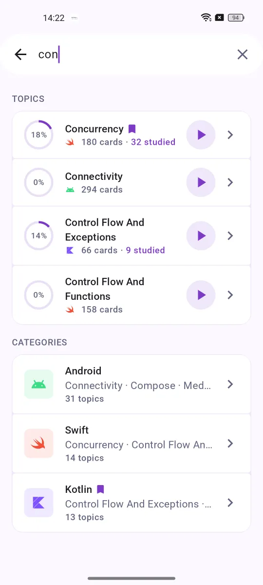</td>
          <td>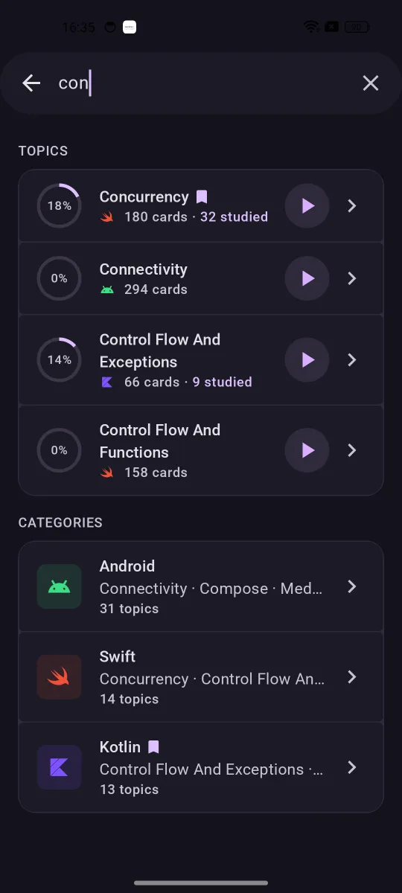</td>
        </tr>
      </table>
    </td>
    <td valign="middle">
      <h3>Search</h3>
      
Search finds Topics and Categories as the query is typed. A matching Topic also brings up its Category, and
      a Topic result can start a session right away.

      
<a href="docs/design/category-search.md">How it works →</a>

    </td>
  </tr>
  <tr>
    <td>
      <table>
        <tr>
          <td>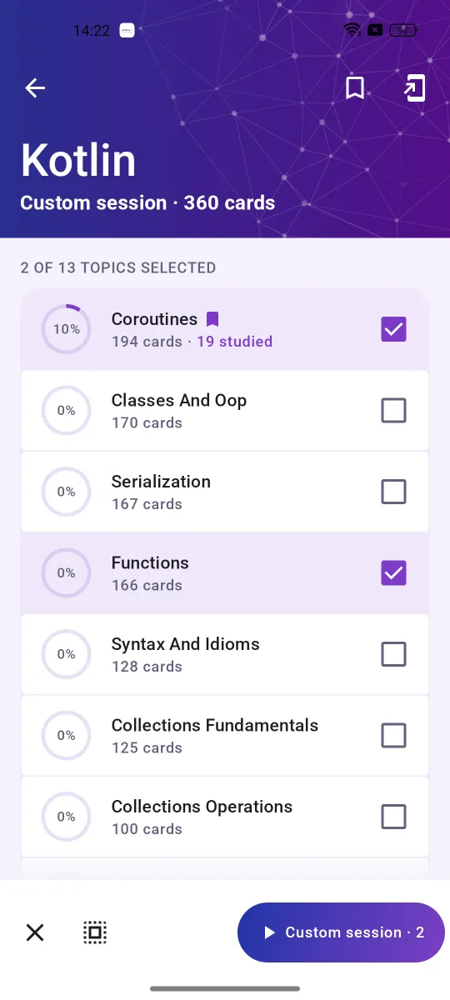</td>
          <td>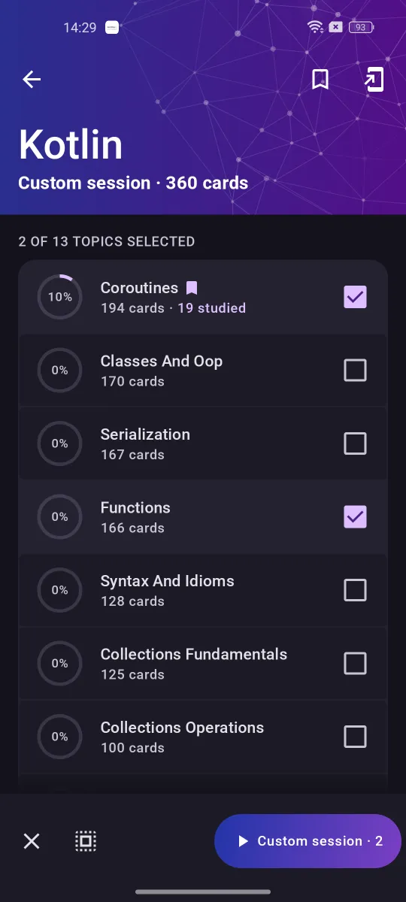</td>
        </tr>
      </table>
    </td>
    <td valign="middle">
      <h3>Selection Mode and custom sessions</h3>
      
Inside a Category, a session can start for one Topic, as a Quick Session with a random mix, or as a custom
      session: a long-press enters Selection Mode and combines the chosen Topics.

      
<a href="docs/design/browse.md">How it works →</a>

    </td>
  </tr>
  <tr>
    <td>
      <table>
        <tr>
          <td>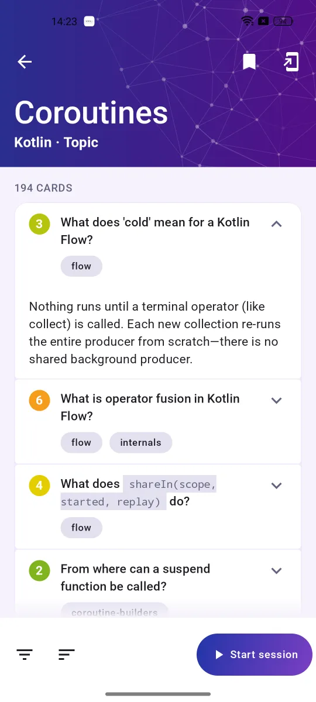</td>
          <td>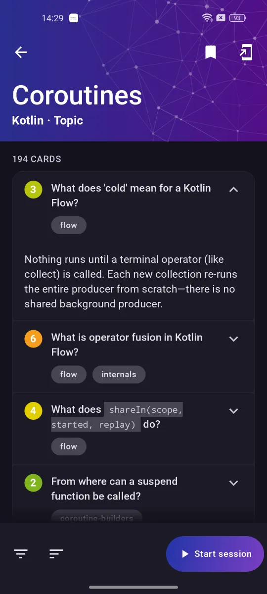</td>
        </tr>
      </table>
    </td>
    <td valign="middle">
      <h3>Topic details</h3>
      
Each Topic lists its cards with their difficulty. The list can be filtered by tags and difficulty and sorted
      easiest or hardest first, and a session can start with exactly the cards shown.

      
<a href="docs/design/browse.md">How it works →</a>

    </td>
  </tr>
  <tr>
    <td>
      <table>
        <tr>
          <td>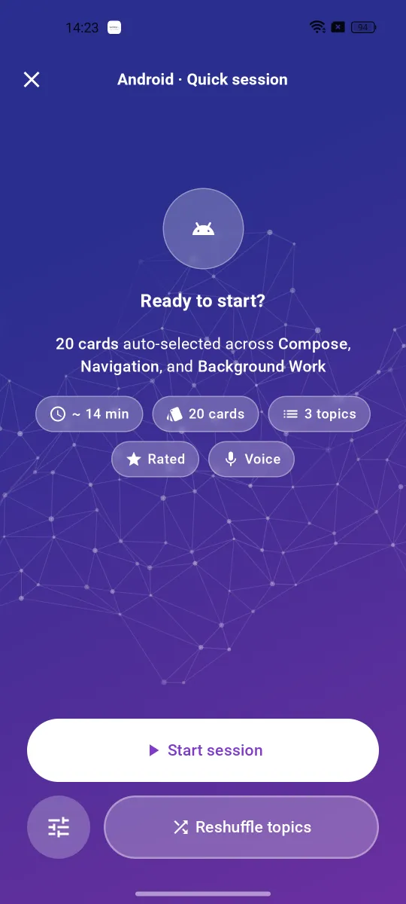</td>
          <td>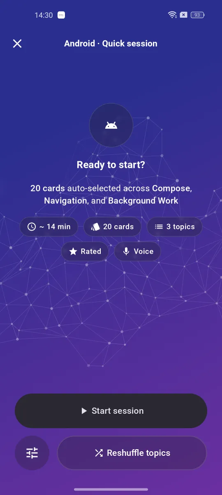</td>
        </tr>
      </table>
    </td>
    <td valign="middle">
      <h3>Session preview</h3>
      
Every session, whichever way it starts, opens on a preview with its card count and estimated time. The mode
      and its delivery, the length, the difficulty range, the filters and the card order are set there, and any of
      them can be saved as the default.

      
<a href="docs/design/preview-study-session.md">How it works →</a> · <a href="docs/design/flashcard-selection.md">Card selection →</a>

    </td>
  </tr>
  <tr>
    <td>
      <table>
        <tr>
          <td>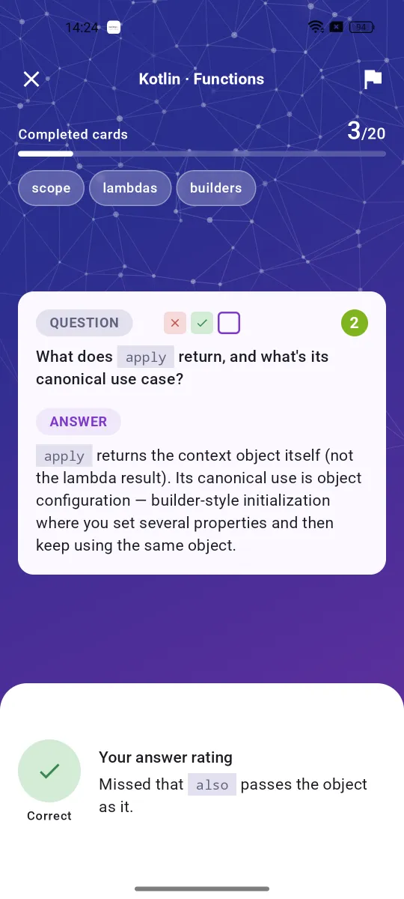</td>
          <td>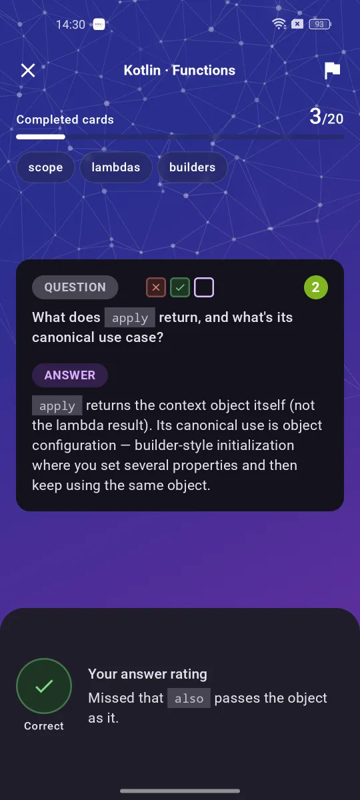</td>
        </tr>
      </table>
    </td>
    <td valign="middle">
      <h3>Rated mode and Voice Answering</h3>
      
The answer is revealed and self-rated Failed, Partial or Correct, or Voice Answering is switched on: the
      question is read aloud, the answer is spoken, and the transcript and grade arrive within seconds. Weaker cards
      come back later in the session, and each card's best rating decides whether it is Mastered. Voice Answering
      keeps going with the screen off and works with Bluetooth earphones.

      
<a href="docs/design/rated-mode.md">How it works →</a> · <a href="docs/design/voice-answering.md">Voice Answering →</a>

    </td>
  </tr>
  <tr>
    <td>
      <table>
        <tr>
          <td>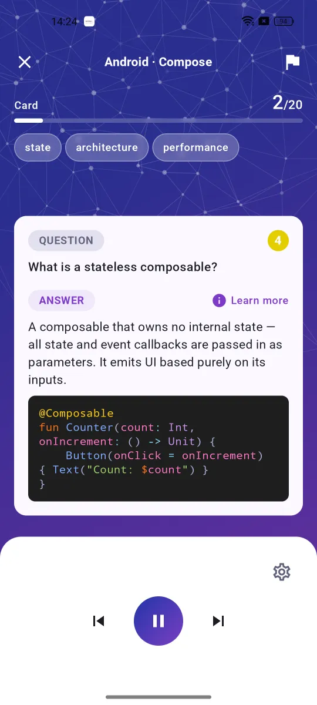</td>
          <td>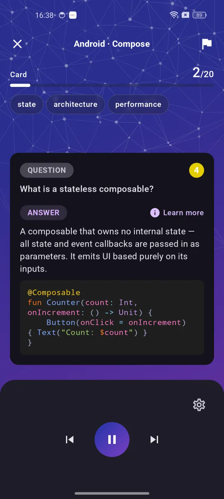</td>
        </tr>
      </table>
    </td>
    <td valign="middle">
      <h3>Fast mode and read-aloud</h3>
      
No grading: question and answer are tapped through, or read-aloud reads each question, pauses, reads the
      answer and moves on. Playback continues in the background, with controls in the notification, on the lock
      screen and on a headset.

      
<a href="docs/design/fast-mode.md">How it works →</a>

    </td>
  </tr>
  <tr>
    <td>
      <table>
        <tr>
          <td>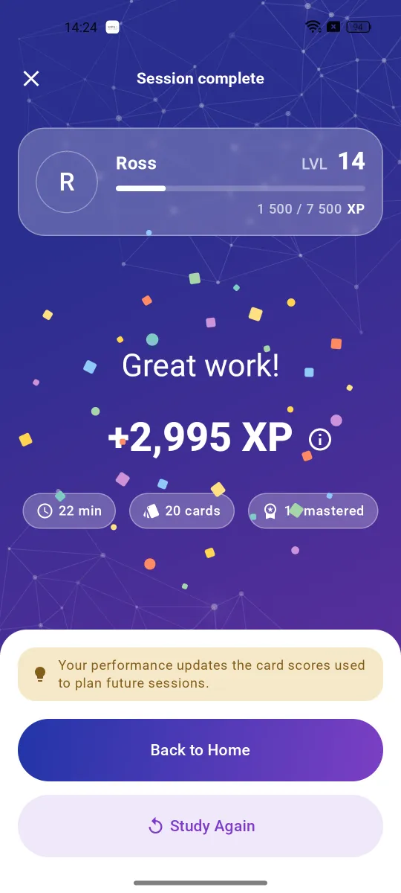</td>
          <td>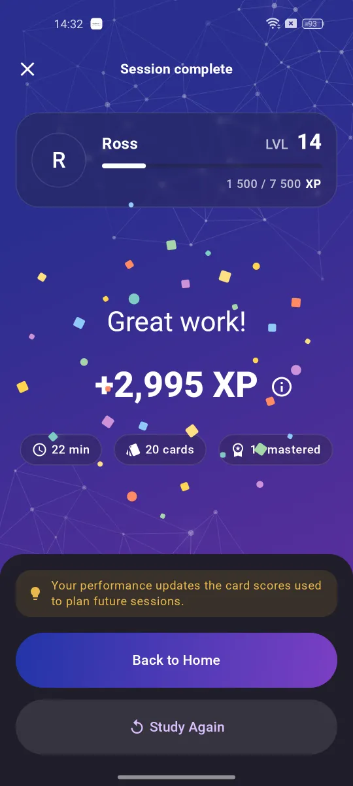</td>
        </tr>
      </table>
    </td>
    <td valign="middle">
      <h3>XP and Levels</h3>
      
The Session Summary breaks down the XP the session earned: new cards, mastered cards, defended mastery,
      finishing the session, the Daily Goal and the Streak. The Level card fills and pulses for every Level crossed.
      The score appears at once, even offline.

      
<a href="docs/design/session-summary.md">How it works →</a> · <a href="docs/design/xp-leveling-system.md">XP and Levels →</a>

    </td>
  </tr>
</table>

## How it's built

### Tech stack

| Area | Technologies |
|---|---|
| UI | Kotlin 2.4, Jetpack Compose, Material 3, Navigation Compose, Coil, Haze (backdrop blur) |
| Platform | Hilt, Coroutines and Flow, Kotlinx Serialization, WorkManager, DataStore, Credential Manager, Android TextToSpeech, Media3 and MediaSession, min SDK 26, target SDK 36 |
| Backend | Firebase Auth (Google, GitHub), Firestore, Cloud Functions (TypeScript, Node 22), App Check with Play Integrity, Crashlytics (with NDK), Hosting |
| AI | ElevenLabs Scribe for speech-to-text, Gemini on Vertex AI for transcript cleanup and grading, Silero VAD on ONNX Runtime for on-device end-of-speech detection |
| Website | Compose Multiplatform for the browser (wasm) |
| Tooling and CI | Bitrise, Spotless with ktlint, detekt, Android Lint, Konsist, Firebase emulators for the Functions and security rules tests |

### Android app modules

Features depend only on `core:ui` and `core:domain`; `core:data` and `core:voice` implement the domain interfaces and are wired in by `:app` with Hilt.

- `:app`: MainActivity, navigation graph, splash and startup, launcher shortcuts, Crashlytics logging, Hilt application
- Feature modules
  - `feature:auth`: Login with Google or GitHub
  - `feature:onboarding`: first-run gallery and the on-device voice test
  - `feature:home`: Level, Streak, Daily Goal, Favorites and Recents
  - `feature:browse`: Categories, search, Category and Subcategory Details, Selection Mode
  - `feature:study`: Preview, Rated and Fast sessions, Session Summary, and the spoken-session runtime (TextToSpeech, MediaSession service, voice capture)
  - `feature:settings`: study defaults and voice settings
  - `feature:account`: Account, Account Deletion, Report a bug, open-source licenses
- Core modules
  - `core:domain`: pure Kotlin models, use cases, repository and gateway interfaces, session reducers and coordinators, XP scoring
  - `core:data`: Firestore and Cloud Functions data sources, DataStore, the Pending Session queue and its WorkManager delivery, sign-in
  - `core:voice`: microphone capture, Silero VAD on ONNX Runtime, voice obfuscation, Bluetooth routing
  - `core:ui`: shared Compose components, dialogs, backdrop blur, navigation helpers
  - `core:designsystem`: theme and design tokens, shared with the website
  - `core:common`: logging and shared helpers
- `:debug-tools`: screen showcase and debug panels, in debug and profiling builds only
- Morpheus (git submodule): the animated graph background

### Highlights

- **Server-authoritative session commit.** A finished session is scored and recorded by a Cloud Function in one
  Firestore transaction: the session, Card Progress, XP, Level, Streak and Daily Goal move together or not at all.
  [ADR-0049](docs/adr/0049-server-authoritative-session-commit.md) · [Session submission](docs/design/session-submission.md)
- **Offline-enabled.** A finished session waits on the device as a Pending Session and is delivered when the
  connection returns. It counts toward progress, XP and Streak at once, scored on the device with the server's rules.
  [ADR-0055](docs/adr/0055-pending-sessions-and-local-progress-projection.md)
- **On-device voice obfuscation.** Every spoken answer has its pitch and formants shifted by a random amount before
  it leaves the phone, so the upload is far less useful for casual re-identification or voice cloning. It is not
  strong anonymization.
  [Voice obfuscation](docs/design/voice-obfuscation.md)
- **Streamed transcribe-then-grade.** One streaming callable transcribes the answer with ElevenLabs Scribe, has an
  LLM clean the transcript and streams it back, then has the LLM grade it, so the transcript is on screen while
  grading is still running.
  [ADR-0028](docs/adr/0028-voice-answering-not-background-only-streamed-transcript-then-grade.md) ·
  [Voice Answering backend](docs/design/voice-answering.md#backend)
- **Enforced architecture.** Multi-module Clean Architecture (`feature:*` over `core:*`), with layer and naming
  rules checked by Konsist and a static-analysis gate (Spotless, detekt, Android Lint) on every pull request.
  [ADR-0011](docs/adr/0011-multi-module-architecture.md) · [CI/CD](docs/ci-cd.md)
- **Spoken sessions in the background.** Playback runs in the background and with the screen off through a
  MediaSession, the microphone routes to Bluetooth earphones, and custom handling of audio interruptions tells a
  notification from a call: short sounds are ignored, an alarm pauses and resumes, a call pauses playback until it is
  resumed.
  [Spoken sessions](docs/design/study-session.md#spoken-sessions) ·
  [ADR-0027](docs/adr/0027-bluetooth-mic-capture-le-audio-first-sco-fallback-bt-strict-screen-off.md)

### System overview

C4 container level.

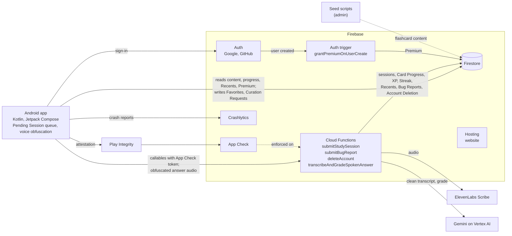

### One Voice Answering round

Sequence diagram.

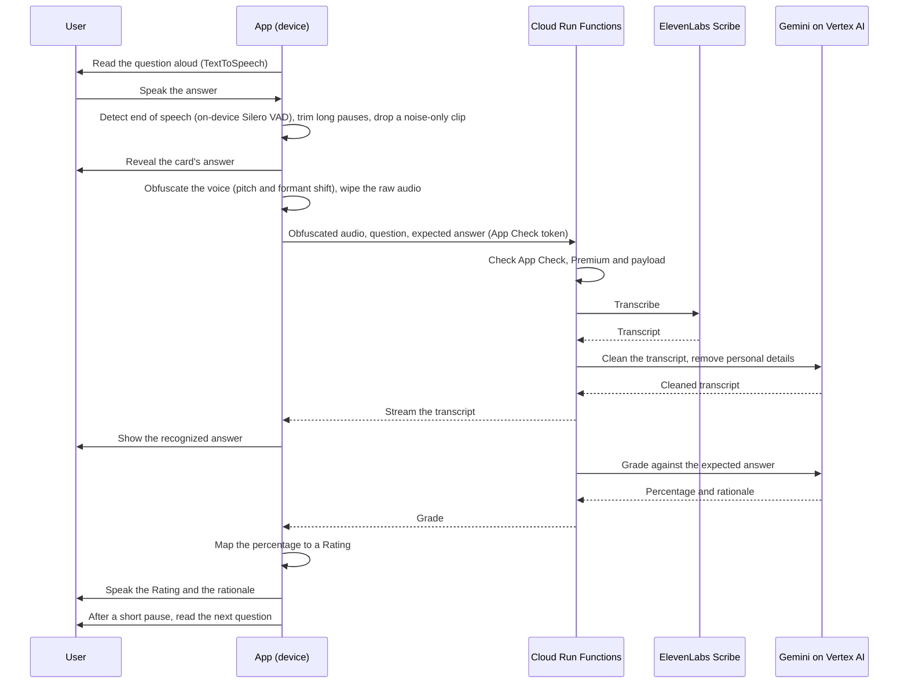

## More features

- Favorite Categories and Topics, and a Recently studied list that replays any past session
- Streak and Daily Goal
- Launcher shortcuts to any Category or Topic, pinned or mirroring the Favorites
- Onboarding with an on-device voice test
- Sign-in with Google or GitHub
- Report a problem on a card, or send a Bug Report from the app
- In-app Account Deletion
- Portrait on phones, free rotation on large screens

## Documentation

| Where | What |
|---|---|
| [docs/design/](docs/design/INDEX.md) | Current design of each feature, one doc per feature |
| [docs/adr/](docs/adr/) | Architecture decision records: decisions and rejected alternatives |
| [docs/user-flow/](docs/user-flow/) | Per-screen action flows as Mermaid diagrams |
| [CONTEXT.md](CONTEXT.md) | Domain glossary |
| [TESTING.md](TESTING.md) | Testing conventions |
| [docs/ci-cd.md](docs/ci-cd.md) | CI pipeline on Bitrise |
| [functions/README.md](functions/README.md) | Cloud Functions setup and contracts |
| [scripts/seed/README.md](scripts/seed/README.md) | Flashcard content seeding into Firestore |

## Development

The app needs a private Firebase project, so it can't be built from a fresh clone.
Setup, commands and checks: [docs/development.md](docs/development.md).

## License

Copyright 2026 Radosław Makowiecki. The source code is licensed under the [Apache License 2.0](LICENSE).

The flashcard content and the brand assets (the Flashcards name, app icon and feature graphic) are not covered by
the license: all rights reserved.
