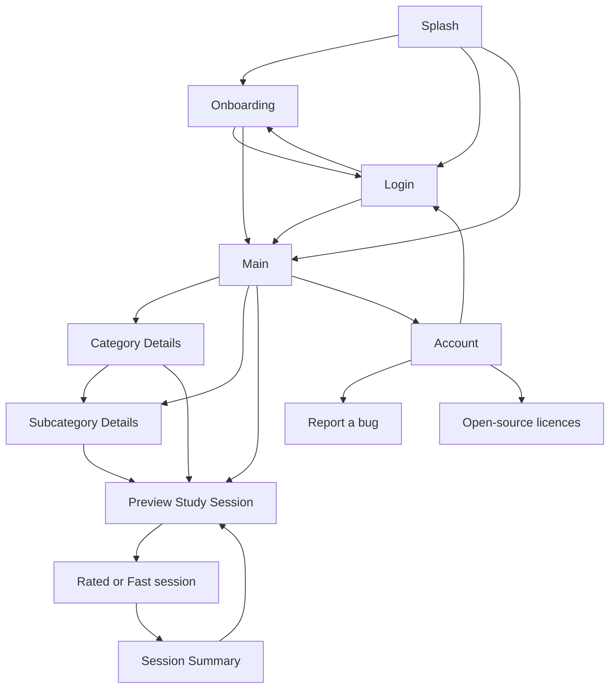

# Navigation

How the app's screens connect: the launch screens and their routing, the tab shell, the full-screen screens above it, the back stack around a Study Session, leaving for Login, and how screens deliver navigation.

## Screens

The app has two levels of navigation. The outer level holds every full-screen destination. One of them, Main, is the tab shell, which hosts its own inner navigation for the tabs.

Every screen outside Main is full-screen, with no bottom navigation bar. Category Details and Subcategory Details are reached from Home, from the Study tab and from launcher shortcuts alike; each is one screen whichever way it is opened.

## Launch

Splash routes a device to exactly one of three places, in this order:

1. **Onboarding**, when this device has not finished onboarding, whether or not someone is signed in. If the onboarding flag cannot be read in time, it counts as seen, because wrongly re-showing onboarding to a returning User is the worse failure.
2. **Login**, when no User is signed in. A **Guest** counts as not signed in, since sign-in is mandatory.
3. **Main** otherwise.

Onboarding goes on to Main for a signed-in User and to Login for anyone else. Login goes on to Main when the device has seen onboarding and to Onboarding when it has not. Each launch screen removes itself on the way out, so back from Main never returns to one. See [onboarding-flow.md](onboarding-flow.md).

**One backdrop under the launch screens.** Splash, Onboarding and Login share one gradient and network graph behind the navigation host, while any of them is shown or leaving. The arriving screen morphs the graph to its own shape while the logo flies across ([ADR-0073](../adr/0073-launch-screens-share-one-backdrop.md)).

- **Splash**: the logo writes itself out, the gradient slides up, the tagline rises, and the graph blooms around the logo, fading in, zooming and turning into place before the handover.
- **Launch screen to launch screen**: the outgoing content fades out fast and stays until the logo lands.
- **To Main**: Main enters opaque and covers the launch screen at once. The backdrop goes once the launch screen has left.
- **From outside the launch flow** (sign-in lost): the old screen is removed at once, the backdrop starts afresh, and the arriving screen fades its graph in.

A launcher shortcut tapped while the app is not running is resolved at Splash, and only when Splash is going to Main. Its Category or Subcategory Details opens on top of Main, so back returns to Main's first tab instead of leaving the app. A shortcut that no longer resolves lands on Main as an ordinary launch. See [launcher-shortcuts.md](launcher-shortcuts.md).

## Tab shell

Main shows a bottom navigation bar with three tabs: Home, Study and Settings. Debug builds add a fourth, the debug hub, which never exists in release builds. Home is the first tab.

- **Each tab is its own small graph** with one root screen. The debug hub's tools open inside its tab, above the bottom bar, except the screen showcase, which opens full screen outside the tab shell ([screen-showcase.md](screen-showcase.md)).
- **Switching tabs saves and restores each tab's state**, and tapping the current tab does not stack it again. A switch swaps instantly, with no transition.
- **A tab stays selected while any screen in its graph is shown.**
- **Home's empty state switches to the Study tab.** This is a plain tab switch, the same as tapping the tab; nothing is pushed.
- **Settings opens Account**, which is full-screen above Main.

## Around a Study Session

Every session starts at the Preview Study Session screen, which owns card selection; no entry point bypasses it ([ADR-0004](../adr/0004-preview-study-session-screen-owns-card-selection.md)). What each entry point sends is in [preview-study-session.md](preview-study-session.md).

- **Preview stays under the session.** Start opens the Rated or Fast session screen above Preview, picked by the chosen Study Mode ([ADR-0045](../adr/0045-separate-fast-and-rated-session-screens.md)). A session that fails to load, or ends with nothing Studied, returns to Preview with nothing recorded.
- **A session that ends with something Studied opens the Session Summary**, whether it reached the end of the deck or the User confirmed leaving. Opening the Summary removes everything between Main and it, the session and Preview included, so a finished session can never be returned to.
- **Leaving the Summary returns to Main** on the tab the User started from, through its own button or system back alike. The Summary only ever shows the session that just ended, never a past one ([ADR-0014](../adr/0014-session-stats-written-at-summary-screen.md)).
- **Study Again replaces the Summary with Preview**, set up as replaying that session's Recent would set it up. Back from that Preview returns to the tab the User started from. See [session-summary.md](session-summary.md).

## Leaving for Login

Losing sign-in, at any time, returns to Login and clears Main and everything above it, so nothing reachable treats a signed-out User as signed in. Signing out and **Account Deletion**, both started from the Account screen ([account.md](account.md)), leave this way, Account Deletion only once the server has finished ([ADR-0060](../adr/0060-account-deletion-completes-on-the-device.md)).

## Orientation

Phones are locked to portrait on every app screen; third-party activities, such as the sign-in pages and debug tools, keep their own orientation. Large screens, with a smallest width of 600dp or more (tablets and unfolded foldables), are never locked and rotate as the User's rotation setting allows, on every Android version. There is no landscape layout yet, so a rotated large screen shows the portrait layout stretched to fit. Folding or unfolding a foldable re-applies the rule for the new screen. Why and how: [ADR-0074](../adr/0074-phones-lock-to-portrait-large-screens-rotate.md).

## Navigation events

A screen's decision to go somewhere is a **one-time event**, never part of its screen state. The screen collects each event once and calls the matching navigation callback, so navigation can never fire twice on recomposition or after a configuration change, and nothing needs resetting afterwards. An event sent before the screen starts collecting waits to be delivered rather than being dropped. Snackbar messages are a separate kind of transient event and do not share this path. Rationale and the code shape are in [ADR-0019](../adr/0019-navigation-as-one-time-events.md).

A screen navigates only while it is the one shown. A tap made while it is leaving, or after another screen covers it, goes nowhere, so a double tap never opens a screen twice or goes back twice ([ADR-0067](../adr/0067-destinations-navigate-only-from-their-own-back-stack-entry.md)).

Every screen whose ViewModel decides where to go uses these events, even for a tap with only one destination. Two taps that need no decision call their navigation callback directly: Home's empty-state button switching to the Study tab, and the Settings avatar that opens Account.

## Related

- [ADR-0019](../adr/0019-navigation-as-one-time-events.md): navigation as one-time events.
- [ADR-0067](../adr/0067-destinations-navigate-only-from-their-own-back-stack-entry.md): destinations navigate only from their own back-stack entry.
- [ADR-0073](../adr/0073-launch-screens-share-one-backdrop.md): the launch screens share one backdrop.
- [ADR-0004](../adr/0004-preview-study-session-screen-owns-card-selection.md): every session goes through Preview.
- [ADR-0074](../adr/0074-phones-lock-to-portrait-large-screens-rotate.md): phones lock to portrait, large screens rotate.
- [ADR-0045](../adr/0045-separate-fast-and-rated-session-screens.md): separate Rated and Fast session screens.
- [preview-study-session.md](preview-study-session.md): what each session entry point sends.
- [session-summary.md](session-summary.md): leaving the Summary and Study Again.
- [onboarding-flow.md](onboarding-flow.md): the onboarding gallery and its exits.
- [launcher-shortcuts.md](launcher-shortcuts.md): shortcuts that open Category or Subcategory Details.
- [account.md](account.md): sign-out and Account Deletion, which leave for Login.
- [docs/user-flow/main.md](../user-flow/main.md): the per-screen action flows for launch and the tab shell. The other files in `docs/user-flow/` cover each tab.
