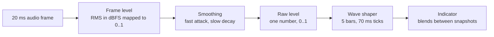

# Voice capture indicator

The voice capture indicator is the animated microphone disc with level bars on each side. It shows that the microphone hears the User, or, in the onboarding voice test, that a recording is being played back. It follows the real audio level, of any sound and not only speech. It is shared by the Rated voice sheet, the onboarding voice test and the debug build's voice screens.

The indicator answers one question for the User: is the phone hearing me? It never answers whether the app counts what it hears as speech. That decision belongs to voice-activity detection, which drives the round ([voice-answering.md](voice-answering.md#capture)) and is not drawn.

## The pipeline

The first three stages run in the voice module and produce a single number. The shaping and the drawing run in the shared UI module, which has no audio knowledge. Between them, the domain and the gateways carry only the raw number, never audio ([ADR-0053](../adr/0053-voice-answer-sheet-states-and-live-input-level.md)).

## Stage 1: frame level

The microphone is read in frames of 20 ms (320 samples at the 16 kHz capture rate). For each frame:

1. Normalize each 16-bit sample by the full-scale amplitude, so samples lie in $[-1, 1]$.
2. Take the root mean square, $\text{RMS} = \sqrt{\tfrac{1}{N}\sum x_i^2}$, which measures the frame's energy.
3. Convert to decibels relative to full scale, $L = 20 \log_{10}(\text{RMS})$. Full scale is 0 dBFS, and quieter sound is negative.
4. Map $L$ linearly onto $0..1$, with −50 dBFS as 0 and −10 dBFS as 1, and clamp:

$$x = \operatorname{clamp}\!\left(\frac{L + 50}{40},\, 0,\, 1\right)$$

A frame of exact digital silence (RMS = 0) is level 0 directly. The window is 40 dB wide, and the scale is logarithmic, so equal steps in the bars are equal steps in decibels.

## Stage 2: smoothing

Raw frame levels jump from frame to frame. A one-pole smoother with different speeds up and down turns them into a level that rises quickly and falls slowly, like a classic level meter:

$$s \leftarrow s + (x - s)\,c, \qquad c = 1 - e^{-\Delta t/\tau}$$

where $\Delta t$ is the frame length (20 ms) and $\tau$ is a time constant that depends on direction:

- **Attack**, when the new frame is louder than the smoothed level: $\tau$ = 30 ms, so $c \approx 0.49$. The level closes about half the gap to a louder frame each frame.
- **Decay**, when it is quieter: $\tau$ = 250 ms, so $c \approx 0.08$. From full scale the level takes about three-quarters of a second to sink to the noise floor.

A smoothed level below 0.05 (about −48 dBFS) is reported as exactly 0. This keeps the faint hiss of a quiet room from nudging the bars. The smoother keeps no audio: after each frame only the last smoothed value survives.

While the session's capture gate is closed, frames are dropped, the level reads 0 and the speech flag is off. The gate closes so that a sound from another app never ends up in the User's answer, and it keeps that sound from moving the bars too.

## Stage 3: wave shaper

The raw level changes every 20 ms, which is too fast and too busy to draw. The shaper turns it into a short history of five bar levels, newest at the disc and older ones moving outward, which reads as a wave travelling away from the User.

Every 70 ms tick:

1. **Hold the peak.** The value used is the maximum raw level seen since the last tick, not the latest one. A short plosive that falls between ticks is not lost.
2. **Shift outward.** The oldest of the five values is dropped, and the peak is inserted at the innermost position. Each value moves one bar outward per tick, so a sound travels the five bars in 350 ms.
3. **Carry the level.** The peak for the next window starts from the level in effect now, so a sustained sound is not lost at a tick boundary.
4. **Emit** the five values as one snapshot, about 14 per second.

The tick interval is the wave's speed, and the indicator animates over the same interval.

**Resting.** When the level falls to 0, zeros shift in and the bars sink to rest over five ticks. After that the shaper emits nothing more and stops its timer, so a silent microphone costs no periodic wake-ups. The first raw level above 0 wakes it, and the first tick follows one interval later.

**Lifetime.** The shaper is cold: it runs only while something collects it, and is kept for a few seconds after the last collector leaves so a rotation does not restart the wave. Each screen's state holder owns its snapshot stream outside the screen state, so a new snapshot recomposes only the indicator.

## Drawing

- **Layout.** A disc in the middle with five bars on each side, mirrored. The innermost bar is next to the disc. The disc is the size of a Rating circle, so either can replace the other in the same spot.
- **Bar height and opacity** both follow the bar's level. Height runs from a short resting height up to the bar's maximum, and opacity from partly transparent to opaque. Each bar has its own maximum, tapering from full for the innermost bar to about three-quarters for the outermost, which gives the wave its rounded silhouette.
- **Blending.** The indicator never decides timing. A snapshot is a static list of five values, and the bars move to it linearly over one tick. A snapshot that arrives mid-blend starts from the bar heights currently drawn, so nothing jumps. Bar values are read only while drawing, so a blend redraws without recomposing.
- **Pulse.** The disc grows and shrinks slightly on a slow loop. The pulse is independent of the level.
- **Active and inactive.** Whether the bars show is decided only by the caller's active flag, never by the level. When it turns on, the bars fan out from the disc, inner bars leading. When it turns off, they fold back in. The indicator keeps its full width either way, so the disc never moves. A level of 0 only lets the bars sink to rest height, it never hides them.
- **Icon.** A microphone by default. While the bars follow playback instead of capture, a speaker icon crossfades in.
- **Accessibility.** The indicator is a single element with one description and a polite live region. The bars and the disc icon are decorative, and the level is never exposed to TalkBack.

## Where it shows

- **Rated voice sheet.** Active only while the sheet is in its listening mode: once the microphone really records, until the User stops speaking. That is the same moment the short listening cue plays. When the round moves to grading, the bars fold into the disc and fade out while the progress disc fades in at the same center ([voice-answering.md](voice-answering.md#on-screen)). A microphone that is still being prepared shows the progress disc, not the indicator.
- **Onboarding voice test.** Active while listening, while speech is detected, while the take is processed and ready, and while it plays back. It rests while the test is idle, after a failure, or when the microphone permission is denied ([onboarding-flow.md](onboarding-flow.md#voice-test)). While the take plays back, the level source switches from the microphone to the clip, and the icon becomes a speaker.
- **Debug build.** The voice tab shows it with the live microphone and with playback, and a separate debug screen exercises the indicator on its own.

### Following a played-back clip

A clip being played has no live microphone, so its level is precomputed once, when playback starts. The clip is cut into the same 20 ms frames and run through the same frame-level mapping and the same smoother as live capture, so playback and capture share one scale. While the clip plays, the player reads the head position every 20 ms and looks up the level of the frame it is in. The level is 0 when nothing is playing. Because the clip is the obfuscated one ([voice-obfuscation.md](voice-obfuscation.md)), the animation follows the transformed audio the User hears.

## Privacy

The level is computed on the device from raw audio and is never logged, stored or uploaded. The stages keep no audio: the meter keeps one smoothed number, and the shaper keeps five values.

## Related

- [voice-answering.md](voice-answering.md): the round, the answer sheet and capture that the indicator belongs to.
- [voice-obfuscation.md](voice-obfuscation.md): the transform the played-back clip has gone through.
- [onboarding-flow.md](onboarding-flow.md#voice-test): the voice test that reuses the indicator.
- [study-session.md](study-session.md#spoken-sessions): the spoken-session behavior around the round.
