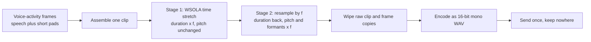

# Voice obfuscation

Voice obfuscation is the on-device transform that every spoken answer goes through before it leaves the phone. It moves the speaker's pitch and vocal-tract resonances by a random amount and keeps the speech rate unchanged. The result is still intelligible to speech-to-text, but the recording no longer carries the speaker's original voiceprint. It deters casual re-identification and voice cloning from a recording. It is not strong anonymization, and the doc says where its limits are.

The transform runs in Voice Answering ([voice-answering.md](voice-answering.md)) and in the onboarding voice test ([onboarding-flow.md](onboarding-flow.md#voice-test)). The debug build's voice tab can play the raw and the obfuscated clip side by side to judge the transform by ear. No other path obfuscates, and no other path uploads audio.

## What it protects

A voice carries two identity cues that survive transcription-friendly processing:

- **Pitch**, the fundamental frequency of the vocal folds.
- **Formants**, the resonances of the vocal tract. Their positions follow the length and shape of the tract, so they are a strong speaker cue that a pitch-only shift would leave in place.

The transform moves both together, by one factor. It follows the idea of vocal tract length perturbation: scaling the whole spectrum makes the voice sound like a speaker with a different tract. Speech-to-text copes with that, because speakers differ in tract length from one another by a comparable margin.

## The pipeline

Capture, voice-activity detection and the Bluetooth routing that feed this pipeline are in [voice-answering.md](voice-answering.md#capture).

### The shift factor

Each shift is a random number of semitones $s$, drawn uniformly from 2 to 4, with the sign picked by a fair coin. The factor is

$$f = 2^{\pm s/12}$$

so a shift of $s$ semitones multiplies every frequency by $f$. That puts $f$ in one of two bands: about 0.79 to 0.89 (down) or 1.12 to 1.26 (up). A band of 2 to 4 semitones is audible and changes the voice clearly, and stays in the range speech-to-text tolerates. The random sign keeps the direction unpredictable.

A new factor is drawn each time the microphone opens for listening, and it holds for every answer captured in that window. Drawing again each time stops two answers from sharing one stable transform that could be correlated.

### Stage 1: time stretch (WSOLA)

Resampling alone would shift pitch and also change the duration by the same factor. So the clip is first stretched by $f$ without changing its pitch, using waveform-similarity overlap-add (WSOLA). The idea is to cut the clip into short overlapping windows and re-lay them at a different spacing, so the signal is repeated or skipped in small pieces instead of being played faster or slower.

With the 16 kHz capture rate:

- **Window.** 480 samples (30 ms), shaped by a Hann window so the pieces fade in and out.
- **Synthesis hop.** Half a window, 240 samples (15 ms). Windows are laid into the output every 240 samples, so each overlaps the next by half.
- **Analysis hop.** The spacing between windows read from the input is $\lfloor 240 / f \rfloor$ samples. Since reading advances by $1/f$ of what writing advances, the output ends up $f$ times as long as the input, and its length is $\lfloor n \cdot f \rfloor$ for an input of $n$ samples.

Copying windows at a different spacing would make a click wherever two windows meet out of phase. To avoid that, each window after the first is nudged before it is laid down:

1. Take the position the window would naturally have had, one synthesis hop after the previous window's start in the input. The next 160 samples (10 ms) from there are the target the new window should continue.
2. Try start positions around the planned analysis position, up to 120 samples (7.5 ms) either way, in steps of 4 samples.
3. Score each candidate by the sum of absolute differences between its first 160 samples and the target.
4. Take the lowest score. That is the start that best continues the waveform already laid down, so the pitch periods line up.

Windows are summed into the output with their Hann weights, and the weights are summed too. Each output sample is the weighted sum divided by the weight sum wherever the weight is meaningful, so the overlap does not change loudness. Samples are clamped to the 16-bit range.

### Stage 2: resample

The stretched clip has $n \cdot f$ samples and the original pitch. It is now resampled: output sample $i$ is read at position $i \cdot f$ in the stretched clip, linearly interpolated between the two neighbouring samples. Played back at the original rate, this has two effects:

- **Duration.** The output has $n \cdot f / f = n$ samples, the original length, so the timing of the speech is unchanged.
- **Frequency.** The signal is read $f$ times as fast as it was written, so every frequency component, pitch and formants alike, is multiplied by $f$.

Together the two stages change pitch and formants by $f$ and leave the duration as it was.

## What leaves the device

- **Only the answer.** The clip holds the speech plus a short pad of silence around each burst of speech. Longer silences inside an answer, such as a thinking pause, are trimmed at capture and never reach the transform or the network. A clip with too little speech is discarded as noise.
- **Raw audio is wiped.** The moment the obfuscated clip exists, the raw clip and the per-frame copies it was assembled from are overwritten with zeros. The raw recording is never encoded, played or sent. The one exception is the debug build's voice tab, which keeps a raw clip for on-device comparison and never uploads it.
- **One send.** The obfuscated clip is encoded and sent once for transcription and grading. It is kept nowhere afterwards ([voice-answering.md](voice-answering.md#privacy)).
- **A guard on tiny clips.** A clip shorter than two windows (60 ms) is returned as an unchanged copy, because the stretch needs at least that much. Capture never keeps a clip that short, so the guard is not reachable in a session.

## Limits

- **Not strong anonymization.** The factor lies in two narrow bands and the transform is a plain scaling, so a determined speaker-identification or inversion effort could estimate and undo most of it. The goal is to make the raw voiceprint unavailable to casual use and to cloning from the recording, nothing more.
- **Audible artifacts.** The stretch repeats and skips small pieces, and the resampler interpolates linearly without a filter. The voice sounds slightly processed. The transform is plain signal processing with no model, and it runs on the phone.
- **Transcription depends on it.** Transcription runs on the obfuscated audio, so a shift that is too large would hurt recognition. That is why the shift is limited to a few semitones.

## Related

- [voice-answering.md](voice-answering.md): the round, capture and the backend that receive the obfuscated clip.
- [onboarding-flow.md](onboarding-flow.md#voice-test): the free voice test that plays the transform back.
- [voice-capture-indicator.md](voice-capture-indicator.md): the microphone indicator that shows while this audio is being captured.
