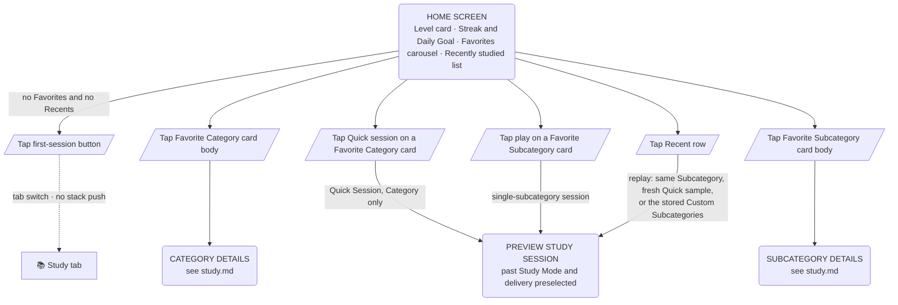

# User Flow — Home

Leaving the Home tab: Favorites, Recents and the first-session prompt. Behavior and states are in [docs/design/home.md](../design/home.md).

Category Details and Subcategory Details are full-screen screens above Main (no bottom nav), the same screens whether opened from Home, the Study tab or a launcher shortcut. Their internal flows are in [study.md](study.md).

