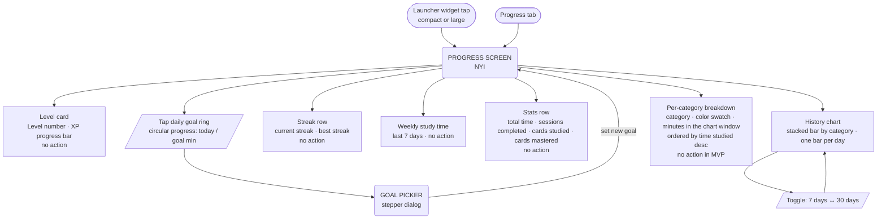

# User Flow — Progress

NYI — flows designed from ADRs and design docs. See [docs/design/planned/progress-dashboard.md](../design/planned/progress-dashboard.md), [docs/design/planned/launcher-widget.md](../design/planned/launcher-widget.md), [docs/design/session-submission.md](../design/session-submission.md).

## Entry points & screen

Widget tap on the device home screen opens the app and navigates directly to the Progress tab. If the app cold-starts, auth check runs first (see [main.md](main.md)).

## Widget sizes

| Size | Content |
|---|---|
| Compact (1 row × 4 columns) | Streak (flame + day count) · Daily goal ring with today's minutes |
| Large (2 rows × 4 columns) | Level number + XP progress bar · Streak · Today's goal · Last 7 days minutes |

The widget reads the same figures as the Progress tab and refreshes on events, not on a timer. See [launcher-widget.md](../design/planned/launcher-widget.md).

## Data sources

Every figure is read from a server-written document and includes Pending Sessions. See [progress-dashboard.md](../design/planned/progress-dashboard.md#where-the-figures-come-from).

| Stat | Source |
|---|---|
| Level, XP, streak, best streak, today's minutes | Scoring state |
| Cards studied, cards mastered | Progress summary |
| Total time, sessions completed, weekly minutes, history chart (7/30 days), per-category breakdown | Activity aggregate |
