# User Flow — Settings

Settings preferences. Every row opens a dialog that saves the value as a default on confirm; see `docs/design/settings.md`. Flag/report management has no screen — see `study.md`'s in-session "Report a problem" flow instead.

```mermaid
flowchart TD

    %% Legend: (Screen)  [/Action/]  {Decision}  ([Entry/Exit])

    Settings(SETTINGS SCREEN)

    %% ── Study Sessions ───────────────────────────────────────────
    Settings --> DailyGoal[/Daily goal — minutes per day/]
    Settings --> SessionCount[/Session length/]
    Settings --> Attempts[/Attempts per card — Rated/]
    Settings --> PartialRequeue[/Partial re-queueing — Rated/]
    Settings --> ModeDefault[/Default study mode\nRated | Fast\nsame value as Preview's\n"keep as default"/]
    Settings --> SortDefault[/Sort order\nDefault | Easiest | Hardest\nsame value as Preview's\n"keep as default"/]
    Settings --> TopicCount[/Quick Session topic count range/]

    %% ── Voice ─────────────────────────────────────────────────────
    Settings --> VoiceAnsweringDefault[/Voice answering default — Rated/]
    Settings --> ReadAloudDefault[/Read-aloud default — Fast/]
    Settings --> VoiceSettings[/Voice — voice and speed\nplays a sample on each edit/]

    DailyGoal & SessionCount & Attempts & PartialRequeue & ModeDefault & SortDefault & TopicCount & VoiceAnsweringDefault & ReadAloudDefault & VoiceSettings --> Dialog(SETTING DIALOG)
    Dialog -->|confirm: saved as default| Settings
    Dialog -->|dismiss| Settings

    %% ── Account ───────────────────────────────────────────────────
    Settings --> TapAvatar[/Tap avatar — top app bar/]
    TapAvatar --> Account(ACCOUNT SCREEN\nsign out · delete account · report a bug)
```

