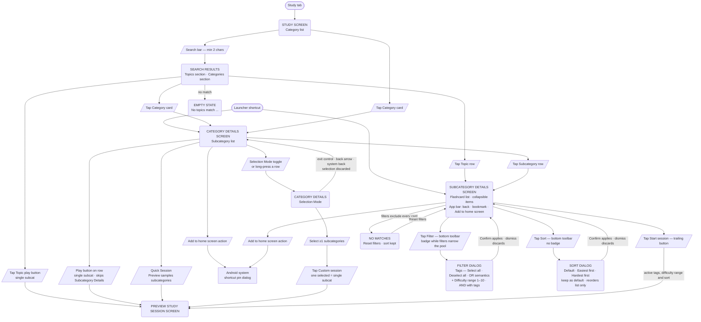

# User Flow — Study

Topic browsing, session entry, studying, and session summary. Launcher shortcuts (pinned to the device home screen) bypass the Study tab and open Category Details or Subcategory Details directly, full-screen above the tab shell. Screen behavior is in [docs/design/browse.md](../design/browse.md).

## Browse & entry

## Session

> Study Mode and delivery are chosen on the Preview Study Session Screen and fixed once the session starts. Fast and Rated are **separate screens and routes** ([ADR-0045](../adr/0045-separate-fast-and-rated-session-screens.md)), so there are four variants: Rated manual, Rated with Voice Answering, Fast tap-through and Fast read-aloud. See [docs/design/study-session.md](../design/study-session.md), [rated-mode.md](../design/rated-mode.md) and [fast-mode.md](../design/fast-mode.md).
>
> Every variant shares the same chrome: a header with close (X) and a flag icon, a progress row, the card's Tags, the card itself (with a "Learn more" link when the card has Extended Context) and a bottom panel whose content depends on the variant. The screen stays on while a session runs. System back opens the same exit confirmation as X.
>
> **Mastery Defense floor (both modes) and shield (Rated only) — NYI:** design only (see [docs/design/planned/mastery-defense.md](../design/planned/mastery-defense.md)).
>
> **Nothing is written while a session runs**, except Curation Requests from "Report a problem", which are sent immediately. A session that ends with at least one Studied card goes to the Session Summary, which queues it as a Pending Session for the server to record ([docs/design/session-submission.md](../design/session-submission.md)). A session that ends with none records nothing and returns to Preview.

```mermaid
flowchart TD

    %% Legend: (Screen)  [/Action/]  {Decision}  ([Entry/Exit])

    PreviewStudySession(PREVIEW STUDY SESSION SCREEN)
    PreviewStudySession --> ModeChoice{Study Mode?}
    ModeChoice -->|Rated| RatedDelivery{Voice answering?}
    ModeChoice -->|Fast| FastDelivery{Read aloud?}
    RatedDelivery -->|off| RatedManual
    RatedDelivery -->|on| VoiceOnline{Online?}
    VoiceOnline -->|no| NoConnection[No-connection dialog\nTry again · Switch to manual]
    NoConnection -->|Try again| VoiceOnline
    NoConnection -->|Switch to manual| PreviewStudySession
    VoiceOnline -->|yes| VoicePremium{Premium?\nasked from the server}
    VoicePremium -->|can't reach the server| NoConnection
    VoicePremium -->|no| ComingSoon[Voice off for this session\nSnackbar: premium feature, coming soon]
    ComingSoon --> PreviewStudySession
    VoicePremium -->|yes| MicHandshake[/Privacy notice once · microphone request/]
    MicHandshake -->|granted| RatedVoice
    FastDelivery -->|off| FastManual
    FastDelivery -->|on| FastReadAloud

    %% ── Rated, manual ─────────────────────────────────────────────
    RatedManual(RATED SESSION — MANUAL\nprogress: completed cards of N distinct\nattempt slots on the card)
    RatedManual --> ShowAnswer[/Tap Show answer/]
    ShowAnswer --> RateButtons[/Rate: Failed · Partial · Correct/]
    RateButtons --> RecordAttempt[Attempt consumed\nbest rating so far updated]

    %% ── Rated, Voice Answering ────────────────────────────────────
    RatedVoice(RATED SESSION — VOICE ANSWERING\ntransport row: previous · play/pause · next\nvoice settings cog between rounds)
    RatedVoice --> ReadQuestion[TTS reads the question]
    ReadQuestion --> Listen[Microphone listens\nlive capture indicator]
    Listen -->|answer spoken| Grade[Transcript shown · graded on the server]
    Grade --> Feedback[Grade read aloud as a Rating\ntap the sheet to skip the feedback]
    Feedback --> RecordAttempt
    Listen -->|silence| Silence{Several silences in a row?}
    Silence -->|no| SilenceSkip[Spoken notice · card skipped\nno Attempt consumed · re-queued further on]
    Silence -->|yes| VoicePause[Spoken notice · session paused\nPlay resumes]
    Grade -->|grading failed| GradeFail[Snackbar · no Attempt consumed\nrepeated failures pause the session]
    Listen -->|microphone lost| CaptureFail[Snackbar · session paused\nPlay resumes]
    RatedVoice -->|microphone permission revoked| MicRevoked[Snackbar · session ends as abandoned]
    RatedVoice --> VoiceNext[/Next: skip the card\nre-queued, no Attempt consumed/]
    RatedVoice --> VoicePrevious[/Previous: restart the question/]
    SilenceSkip --> RatedVoice
    VoiceNext --> RatedVoice
    VoicePrevious --> RatedVoice

    %% ── Rated queue ───────────────────────────────────────────────
    RecordAttempt --> Resolve{Correct, attempts exhausted,\nor Partial with Partial re-queueing off?}
    Resolve -->|yes| Terminal[Terminal State = best rating achieved\nMastered · Partial · Failed]
    Resolve -->|no| Requeue[Re-inserted a random distance ahead\nFailed 2–4 · Partial 5–9]
    Requeue --> RatedNext
    Terminal --> QueueCheck{Queue empty?}
    QueueCheck -->|no| RatedNext[Next card]
    QueueCheck -->|yes| EndRated[Session complete]
    RatedNext -.->|manual| RatedManual
    RatedNext -.->|voice: after the feedback, auto-advance| RatedVoice

    %% ── Fast, tap-through ─────────────────────────────────────────
    FastManual(FAST SESSION — TAP-THROUGH\nprogress: card X of N)
    FastManual --> FastShow[/Tap Show answer/]
    FastShow --> MarkSeen[Answer shown — card Studied]
    MarkSeen --> FastNext[/Tap Next/]
    FastNext --> FastQueueCheck{Last card?}

    %% ── Fast, read-aloud ──────────────────────────────────────────
    FastReadAloud(FAST SESSION — READ ALOUD\ntransport row: previous · play/pause · next\nvoice settings cog\nkeeps playing with the screen off or the app in the background\nsame controls in the notification and on a headset)
    FastReadAloud --> TtsLoop[TTS: question → pause → answer → pause → auto-advance]
    TtsLoop --> MarkSeen
    TtsLoop --> FastQueueCheck
    FastReadAloud --> FastSkip[/Next: at a question shows the answer\nat an answer moves on/]
    FastReadAloud --> FastBack[/Previous: restart the card or go back one/]
    FastQueueCheck -->|no| FastContinue[Next card]
    FastQueueCheck -->|yes| EndFast[Session complete]
    FastContinue -.->|tap-through| FastManual
    FastContinue -.->|read aloud| FastReadAloud

    %% ── Voice engine failure (any spoken variant) ─────────────────
    RatedVoice & FastReadAloud -->|TTS engine unavailable| EnginePause[Snackbar with a link to TTS settings\nsession paused · Play retries]

    %% ── Dialogs shared by every variant ───────────────────────────
    AnyCard([Any variant, a card on screen]) --> TapLearnMore[/Tap Learn more/]
    TapLearnMore --> ExtCtx(EXTENDED CONTEXT DIALOG)
    ExtCtx -->|dismiss| AnyCard
    AnyCard --> TapFlag[/Tap flag icon/]
    TapFlag --> ReportDialog(REPORT A PROBLEM DIALOG\none checkbox per Curation Action · Submit)
    ReportDialog -->|Submit ≥1 action| CurationUpsert[Curation Request upserted immediately\ncard stays in the queue\nfailure shows a snackbar]
    ReportDialog -->|dismiss| AnyCard
    CurationUpsert --> AnyCard
    AnyCard --> TapCog[/Tap voice settings cog\nspoken variants only/]
    TapCog --> VoiceDialog(VOICE SETTINGS DIALOG\nvoice and speed · plays a sample\nplayback pauses while it is open)
    VoiceDialog --> AnyCard

    %% While a dialog is open during a spoken variant, reading continues, but the session holds at
    %% the auto-advance point until the dialog closes (ADR-0013).

    %% ── Exit ──────────────────────────────────────────────────────
    AnyCard --> TapX[/Tap X or system back/]
    TapX --> ExitConfirm{Exit session?\neverything studied so far is saved}
    ExitConfirm -->|Cancel| AnyCard
    ExitConfirm -->|Exit| Abandon[Ends as abandoned\nRated: a re-queued card with a completed Attempt\nis resolved from its best rating so far]

    %% ── Hand-off ──────────────────────────────────────────────────
    EndRated & EndFast & Abandon & MicRevoked --> Studied{Any card Studied?}
    Studied -->|no| PreviewStudySession
    Studied -->|yes| Summary

    %% ── Session Summary ───────────────────────────────────────────
    Summary(STUDY SESSION SUMMARY SCREEN\nevery session that Studied a card ends here, completed or abandoned\nqueues the session as a Pending Session · the server scores and records it\nshows the server's XP, or a local preview when it can't wait for it\nXP breakdown animated line by line · Level card pour)
    Summary --> StudyAgain[/Study Again/]
    Summary --> GoBack[/Tap 'Back to Home' · or system back/]

    StudyAgain -->|"replays as the session's Recent would\npopUpTo Main · card selection runs fresh"| PreviewStudySession
    GoBack -.->|"popUpTo Main (inclusive=false)\nreturns to whichever tab was active"| NavRoot([Main Screen])
```

